# UP-Term

A modern terminal, a Unix userland and a flat desktop for AmigaOS 3.x (68020 or better, AmigaOS 3.0 and up; tested most on 3.2).

- **UP-Term / vtcon**: a console window (`XCON:`) with a real terminal inside: 16, 256 and RGB colours, alternate screen, mouse, bracketed paste, sixel and kitty pictures, tabs, lines that re-wrap on resize. Unix ports (bash-compatible `vsh`, vim, tmux, less, git, ssh, curl) and Amiga programs both render right.
- **Amarchy**: a desktop suite on top of Workbench: Left Amiga key shortcuts for the whole machine, a bar, menus, notices, themes, and `amarchy-flat`, which gives system gadgets (buttons, check boxes, input fields, sliders, Preferences programs) a flat look.
- **upkg**: a package manager (opkg) with a feed of 28 add-ons: Neovim, Python 3.14, git, Perl, vim, BitchX, vbcc, Directory Opus 5.104 and more, from the Shell or a Workbench window.

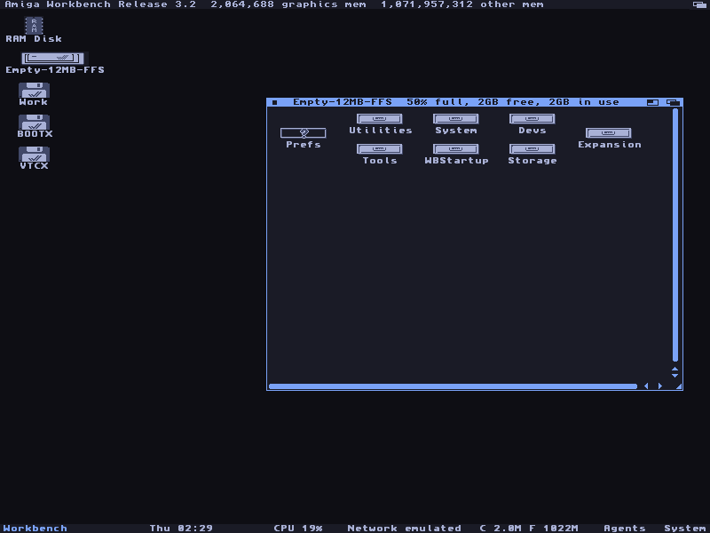

| | |
|---|---|
| 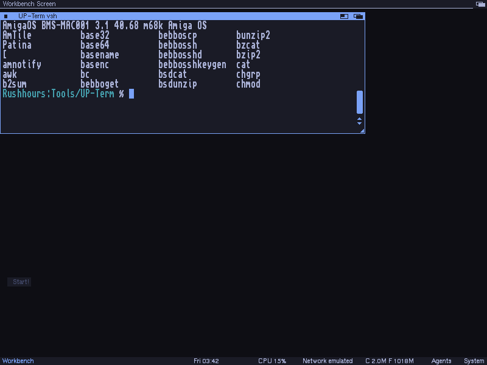 | 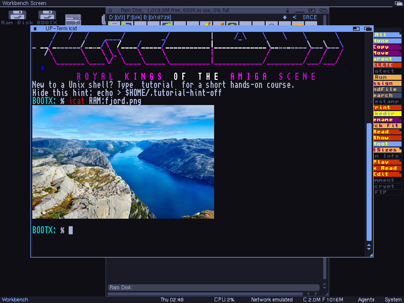 |
| 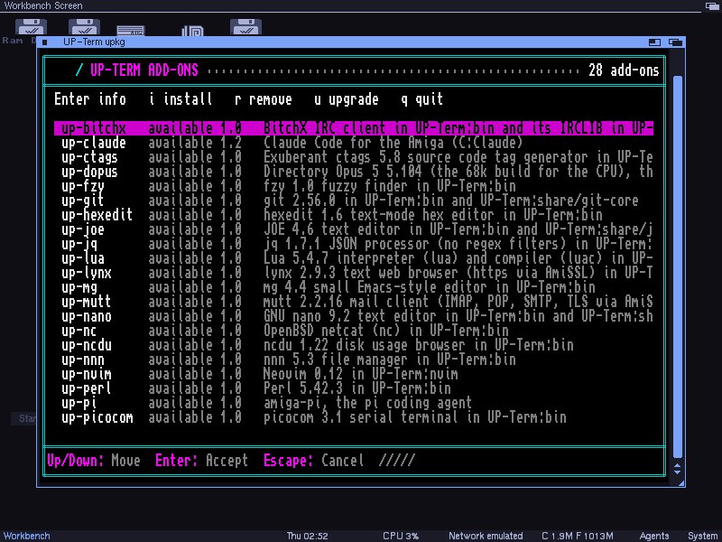 | 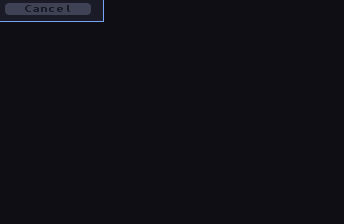 |

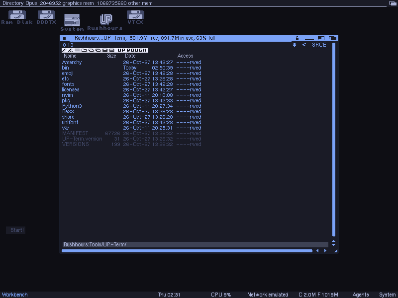

Amarchy themes: the bar, the windows and the gadgets follow the theme you pick.

| | | |
|---|---|---|
| 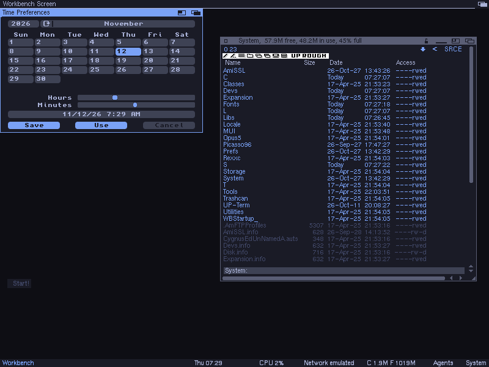 | 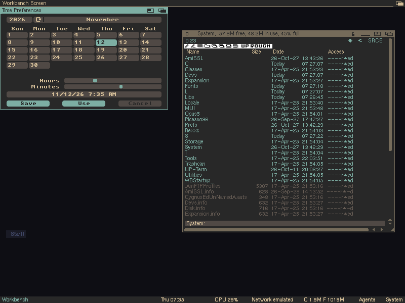 | 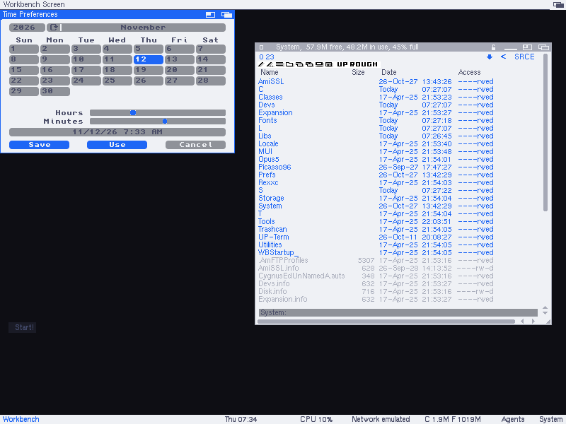 |

The Amarchy menu opens with Left Amiga + Space. Style > Amarchy theme lists the themes and switches to the one you pick.

| | |
|---|---|
| 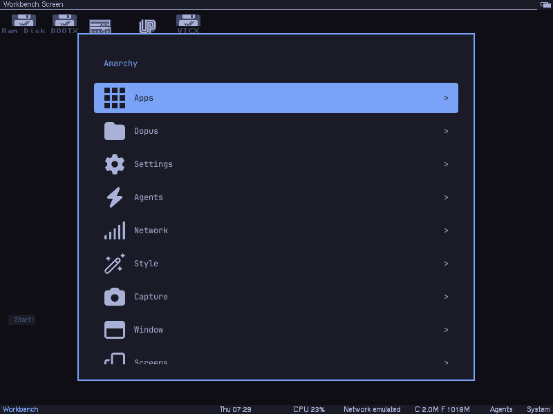 | 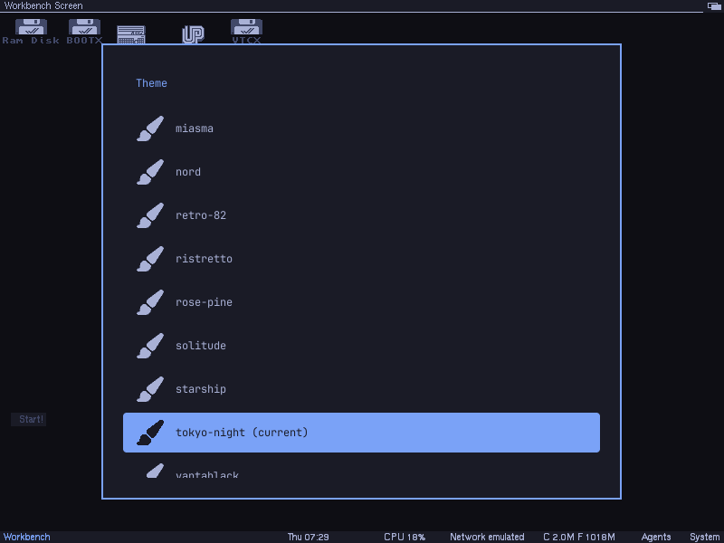 |

## Download and install

Releases are on [spotUP/vtcon](https://github.com/spotUP/vtcon/releases/latest). Current: 1.1.

| Archive | What it is | Use it when |
|---|---|---|
| `up-term.lha` (33 MB) | The base kit: terminal, Amarchy, Unix userland, upkg | The Amiga has a network: add-ons come through upkg |
| `up-term-full.lha` (70 MB) | The base kit plus all 28 packages in a `Packages` drawer | The Amiga has no network |
| `up-term-boot.lha` (5.7 MB) | A small downloader: fetches `up-term.lha` over https (certificate-checked) and starts its install; on an Amiga with no TCP/IP stack it first installs AmiNetXDuo (asks for the network card and DHCP), then asks you to reboot and run it again | You want the smallest file to carry over: unpack, `CD` into the drawer, `Execute Get-UP-Term TO <drawer with 110 MB free>`. Needs `lha` in the path |
| `up-claude.lha`, `up-dopus.lha`, `up-nvim.lha`, `up-pi.lha`, `up-python.lha`, `up-uhc.lha` | Add-ons with their own Install | You want one add-on without upkg |
| `up-term-src.lha` | The sources of everything shipped | |

1. Copy the archive to the Amiga and unpack it: `lha x up-term.lha`.
2. Double-click `Install` in the `up-term` drawer (needs Installer; AmigaOS 3.2 has it). From a Shell without Installer: `Execute Files/install.dos Files`.
3. Reboot when Install offers to.
4. Add-ons, with a TCP/IP stack running: `upkg update`, then `upkg browse` (or double-click `UP-Term:bin/upkg`). From the full kit, with no network: in a Shell, `CD` to the unpacked drawer and `Execute Install-Packages`.

Update: install a newer kit over the old one; Install offers Update and copies only the files that changed. Add-ons: `upkg update`, then `upkg upgrade`.

The network parts are optional and need a TCP/IP stack (Roadshow, Miami or AmiTCP) and AmiSSL 5 for curl.

## Documentation

- [dist/README.txt](dist/README.txt): the manual that ships in the kit: install, update, use, menu, keys, tmux, Amarchy, serial login, network, add-ons.
- [dist/LICENSES.txt](dist/LICENSES.txt): the licences of every shipped part.
- [Release notes](https://github.com/spotUP/vtcon/releases): changes and known issues per release.

## The terminal engine

One terminal engine with three personalities, so that Amiga programs and Unix ports both render right.

- `amiga`  -- the ROM console.device dialect (RKM Devices, console chapter),
  including the private Amiga sequences and pen semantics.
- `xterm`  -- what ixemul/libnix ports of bash, vim, less and mc expect
  (`TERM=vtcon`, see `terminfo/`).
- `pcansi` -- ANSI.SYS / BBS art: bold means bright, iCE colours, CP437.

The same bytes mean different things in the Amiga and xterm dialects (for
example `CSI n u` sets the line length on the Amiga and restores the cursor
in xterm), so a window carries exactly one personality at a time.

## Source layout

| Directory | Content |
|-----------|---------|
| `engine/` | `vtengine`: parser, cell model, personalities. Portable C, no OS calls, runs on the host and on a plain 68000 (DCTelnet builds it for 68000). |
| `render/` | Amiga renderer behind the engine's damage/scroll callbacks. |
| `handler/` | `vtcon-handler`, the DOS handler (`XCON:`, later `CON:`/`RAW:`). |
| `device/` | Later: the console.device replacement. |
| `terminfo/` | The terminfo entry that matches the xterm personality exactly. |
| `view/` | `hl` (a source in syntax colours, 22 languages) and `mdv` (Markdown formatted for the window): a table-driven lexer and a renderer in portable C, AmigaDOS and host front ends (`make view-host`). |
| `tests/` | Host suites (`make test`) and rig scripts. |

## Colour themes

A window's colours are a profile in `ENVARC:up-term/up-term` (see
`dist/README.txt`). Themes downloaded for another terminal convert to one:

```sh
tools/theme_import.py Apprentice.itermcolors      # prints the profile text
tools/theme_import.py --name night --out night.conf theme.toml
```

It reads Terminal.app (`.terminal`), iTerm2 (`.itermcolors`), Alacritty
(`.toml`), Warp (`.yaml`) and Ghostty (flat `key = value`), picking the format
from the file's content rather than its name. All five carry the same sixteen
ANSI colours and round-trip exactly through `upconf_palette_parse`. Run
`tools/theme_import.py --self-test` for the checks.

No single format is best on its own, so take two. Measured over a 36-theme
set, all five agree exactly on `fg`, `bg` and all sixteen palette colours, so
colour fidelity is a tie - but they differ on two other things. The Warp
`.yaml` and Terminal.app `.terminal` exports keep the accent the author chose
for the cursor; the flat, `.itermcolors` and `.toml` exports set it to the
foreground on 28 themes of 36, which says nothing. Conversely the Warp
`.yaml` carries no selection colours at all, while the Alacritty `.toml`
does, and it is the only readable format with a theme's name in it.

So convert from the `.toml` and pass `--cursor-from` a folder of the same
themes in `.yaml`, which supplies the name and restores the accent:

```sh
python3 tools/theme_import.py --cursor-from themes Nord.toml
```

The tool only takes the fallback's cursor where this one's is merely the
foreground, so a theme that genuinely chose the foreground as its cursor
keeps it. `.terminal` is the runner-up for the accent, but one theme in 36
ships malformed XML that will not parse.

Colours are exact on a true-colour or AGA screen. On OCS/ECS a window has 16
pens and the renderer takes the nearest one per colour, so a theme whose
colours sit close together collapses - Apprentice, for one, pairs colour 2
with colour 7 at 33 levels apart and runs four greys through an 80-level
range, landing on about five distinct pens. A scheme built for 256 colours
shows its true self on 4-bit hardware.

## Credits

The flat Workbench icons are Phosphor Icons, Fill weight (https://phosphoricons.com, MIT licence), pinned as @phosphor-icons/web 2.1.2 in the Makefile; the licence text ships in the kit as Files/phosphor/LICENSE and dist/LICENSES.txt lists it.
